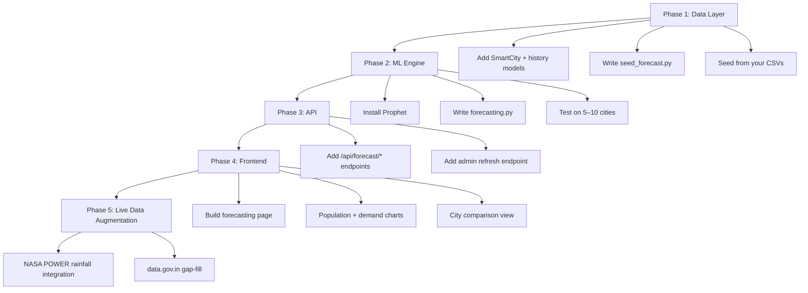

# AI Water Demand Forecasting — WaterAudit Feature Plan
> Scope: 100 Smart Cities of India | Stack: FastAPI + Firebase Auth + Next.js

---

## What This Feature Does

A standalone **Forecasting Module** inside the WaterAudit dashboard that:
- Takes **population history** (1981–2024, census + interpolation) and **historical water supply/demand data** as input
- Runs a **Prophet-based ML forecast** per city
- Shows a **10–20 year forward projection** with confidence intervals
- Allows users to compare cities, see supply-demand gaps, and export results

This sits alongside the existing audit/project workflow — it's a **city-level public analytics tool**, not tied to individual user projects.

---

## How It Fits Into WaterAudit's Existing Architecture

```
Current WaterAudit:
  Users → Projects → DataInput → Results (audit-focused, per-project)

New Forecasting Module:
  City DB (100 smart cities) → Forecasting Engine → Public Dashboard Page
  (No Firebase auth required to view — can be public or admin-seeded)
```

The forecasting data is **city-level and global** (not per-user/project), so it lives in its own set of tables separate from the existing `users/projects/data_inputs` structure.

---

## Data Options

### Option A — Your Own Data (Fastest, Most Reliable)

If you have CSVs with population and water supply per city, this is the cleanest path:

```
Your CSVs → seed_forecast.py → New DB tables → FastAPI → Frontend
```

**What you need in your CSVs:**
| Column | Description |
|--------|-------------|
| `city` | City name (match Smart Cities list) |
| `year` | e.g. 1981, 1991, 2001, 2011, 2021 |
| `population` | Census population |
| `supply_mld` | Water supply in Million Litres/Day |
| `demand_mld` | Estimated demand (optional, can be derived) |
| `per_capita_lpcd` | Litres Per Capita per Day (optional) |

---

### Option B — Third-Party / Official Data Sources

| Source | Data | API? | Reliability |
|--------|------|------|-------------|
| **data.gov.in** | Urban water supply, population datasets | ✅ REST API (free, needs API key) | ⭐⭐⭐⭐ |
| **World Bank Open Data** | Population (state/national level only) | ✅ REST API (free, no key) | ⭐⭐⭐⭐⭐ |
| **NASA POWER API** | Rainfall/climate since 1981 (per lat/lon) | ✅ REST API (free, no key) | ⭐⭐⭐⭐⭐ |
| **Open-Meteo** | Historical + forecast rainfall | ✅ REST API (free, no key) | ⭐⭐⭐⭐ |
| **Census of India** | Ward/city-level population | ❌ No API — PDFs/Excel only | ⭐⭐⭐ |
| **India-WRIS** | River/reservoir water data | ✅ Partial API | ⭐⭐⭐ |
| **CGWB** | Groundwater levels | ❌ Manual download | ⭐⭐ |
| **AMRUT/Smart Cities reports** | ULB water supply infra | ❌ PDFs only | ⭐⭐ |

> [!IMPORTANT]
> **Realistic verdict:** For city-level water supply/demand data in India, **no single public API covers all 100 Smart Cities**. `data.gov.in` is your best bet for supplementing gaps. Population can be seeded from Census data (5 data points: 1981–2021) and interpolated.

### Option C — Hybrid (Recommended for 100 Cities)

1. **Seed base data** from your CSVs (supply + census population for known cities)
2. **Auto-fill rainfall** from NASA POWER API (free, lat/lon-based, no key needed)
3. **Gap-fill population** from World Bank API where census data is missing
4. **Flag gaps** in the UI where data confidence is low

---

## ML Model Recommendation

| Model | Best For | Verdict |
|-------|----------|---------|
| **Prophet** | Annual time series, handles gaps, CI bands | ✅ **Best fit** |
| **Linear Regression** | Simple baseline | Use as fallback comparison |
| **LSTM** | Complex patterns, needs 100+ data points | Overkill for 5 census points |
| **ARIMA** | Stationary series | Prophet handles this better |

**Why Prophet for this case:**
- Works with as few as **5 data points** (5 census years)
- Produces **uncertainty intervals** (important for policy use)
- Handles **irregular time intervals** (census isn't annual)
- Built-in support for **multiple regressors** (add rainfall as a predictor)
- `pip install prophet` — lightweight, no GPU

---

## Proposed Architecture

### New DB Tables (add to `models.py`)

```python
class SmartCity(Base):
    __tablename__ = "smart_cities"
    id           = Column(Integer, primary_key=True)
    name         = Column(String, unique=True, index=True)
    state        = Column(String)
    lat          = Column(Float)
    lon          = Column(Float)
    category     = Column(String)   # e.g. "Tier 1", "Tier 2"

class CityPopulationHistory(Base):
    __tablename__ = "city_population_history"
    id           = Column(Integer, primary_key=True)
    city_id      = Column(Integer, ForeignKey("smart_cities.id"))
    year         = Column(Integer)
    population   = Column(Integer)
    source       = Column(String)   # "census", "interpolated", "worldbank"

class CityWaterHistory(Base):
    __tablename__ = "city_water_history"
    id               = Column(Integer, primary_key=True)
    city_id          = Column(Integer, ForeignKey("smart_cities.id"))
    year             = Column(Integer)
    supply_mld       = Column(Float)   # Million Litres/Day
    demand_mld       = Column(Float)
    per_capita_lpcd  = Column(Float)   # Litres Per Capita Per Day
    nrw_percent      = Column(Float)   # Non-Revenue Water %
    source           = Column(String)

class CityForecast(Base):
    __tablename__ = "city_forecasts"
    id              = Column(Integer, primary_key=True)
    city_id         = Column(Integer, ForeignKey("smart_cities.id"))
    forecast_year   = Column(Integer)
    pop_forecast    = Column(Float)
    demand_forecast = Column(Float)
    supply_gap      = Column(Float)
    lower_ci        = Column(Float)   # 80% confidence lower bound
    upper_ci        = Column(Float)   # 80% confidence upper bound
    generated_at    = Column(DateTime)
```

### New Backend Files

**`backend/forecasting.py`** — Core ML engine
```python
# Uses Prophet to:
# 1. Fit population growth model on historical data
# 2. Project population for next N years
# 3. Derive per-capita demand × projected population
# 4. Return forecast + confidence intervals
```

**`backend/seed_forecast.py`** — Seeds city + historical data from your CSVs

**New API Endpoints** in `main.py`
```
GET  /api/forecast/cities              → List all 100 smart cities
GET  /api/forecast/cities/{city_id}    → City detail + historical data
GET  /api/forecast/run?city_id=&years= → Run/return ML forecast
GET  /api/forecast/compare?ids=1,2,3   → Multi-city comparison
POST /api/forecast/refresh             → Admin: re-run forecasts (protected)
```

### New Frontend Pages/Components

```
frontend/app/dashboard/
  forecasting/
    page.tsx                    ← Main forecasting dashboard page

frontend/components/forecasting/
  CitySelector.tsx              ← Searchable dropdown for 100 cities
  PopulationTrendChart.tsx      ← Historical + projected population line chart
  WaterDemandChart.tsx          ← Supply vs demand vs forecast with CI band
  SupplyGapCard.tsx             ← KPI card: gap in MLD
  CityComparePanel.tsx          ← Side-by-side city comparison
  DataConfidenceBadge.tsx       ← Shows data source quality indicator
```

---

## Implementation Roadmap



---

## Things I Need From You Before Building

1. **Your data format** — Can you share a sample of your water supply CSV? (columns, units, year range)
2. **City list** — Do you have a fixed list of the 100 Smart Cities to seed, or should I generate it from the official list?
3. **Forecast horizon** — 10 years? 20 years? Up to 2050?
4. **Access control** — Should the forecasting page be public (no login needed) or restricted to logged-in users / admins only?
5. **NRW data** — Do you have Non-Revenue Water (water lost to leakage) data? This is key for realistic demand forecasting.
